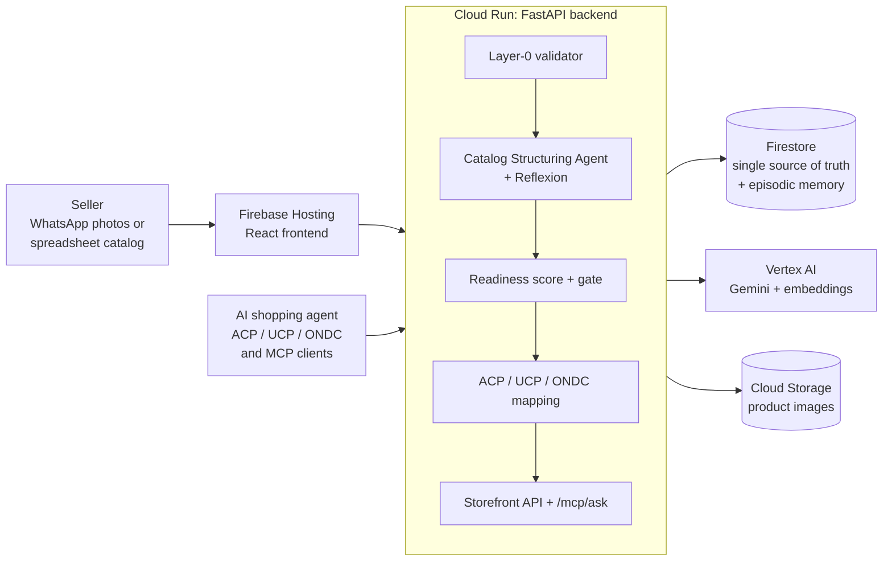
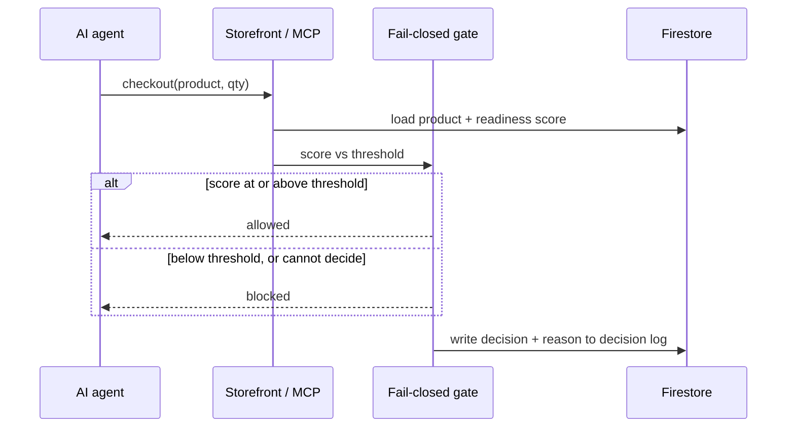
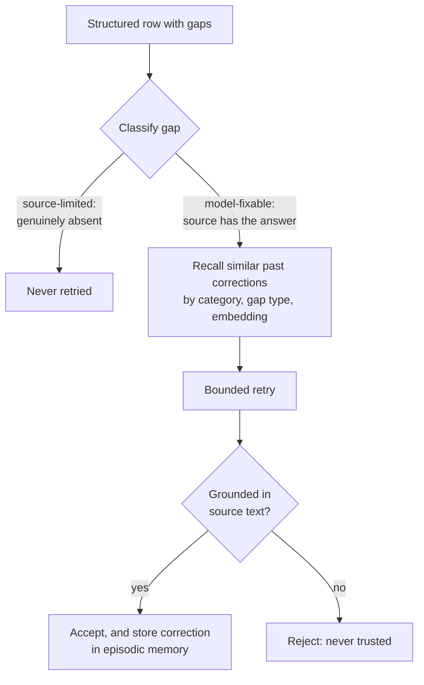
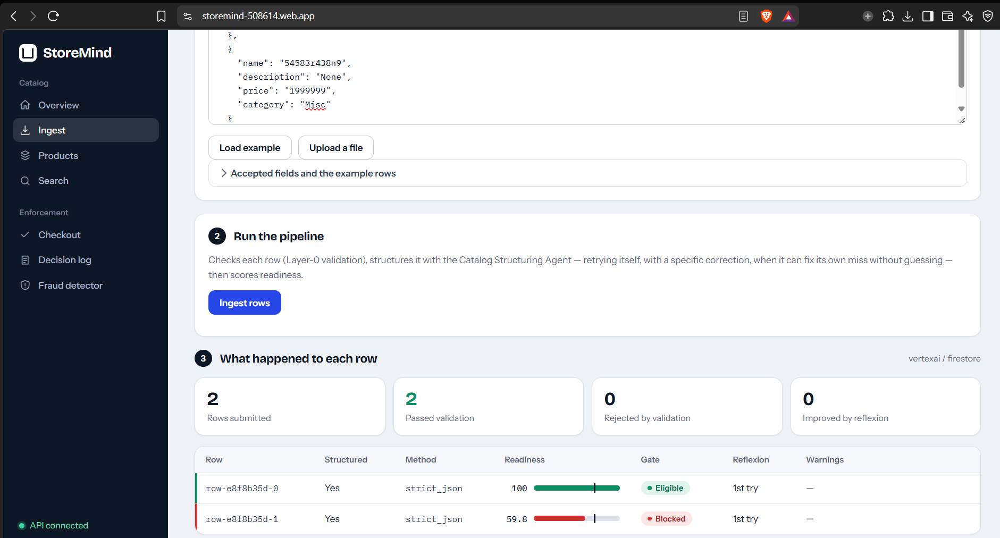
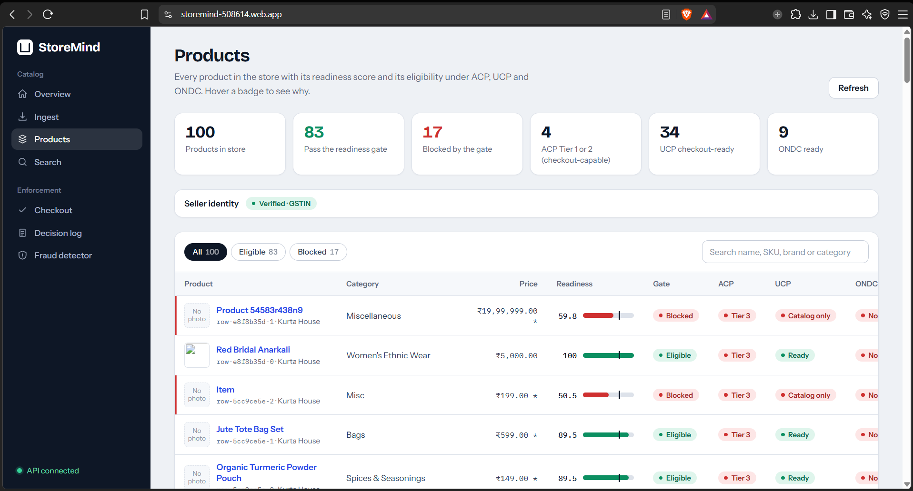
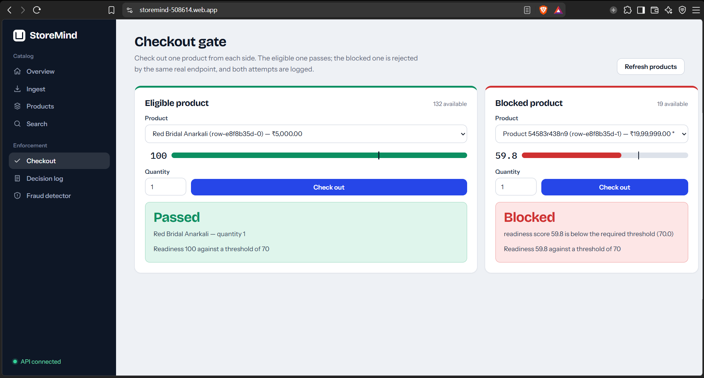
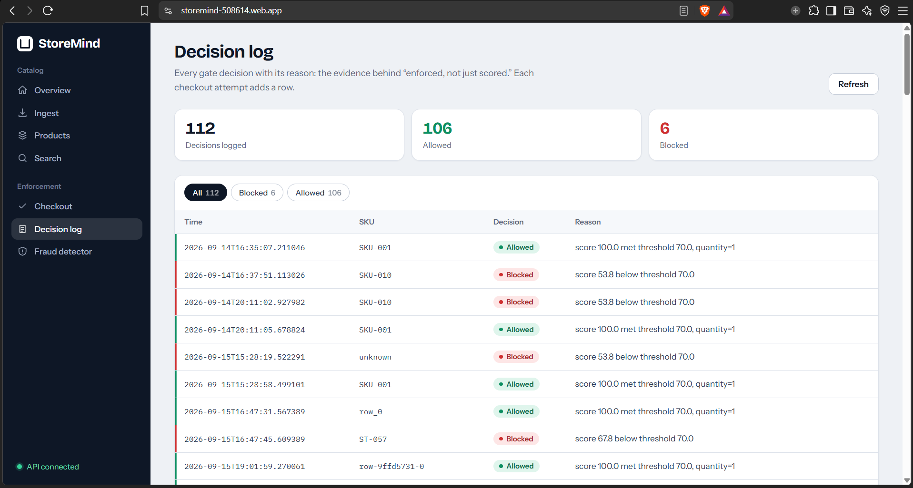
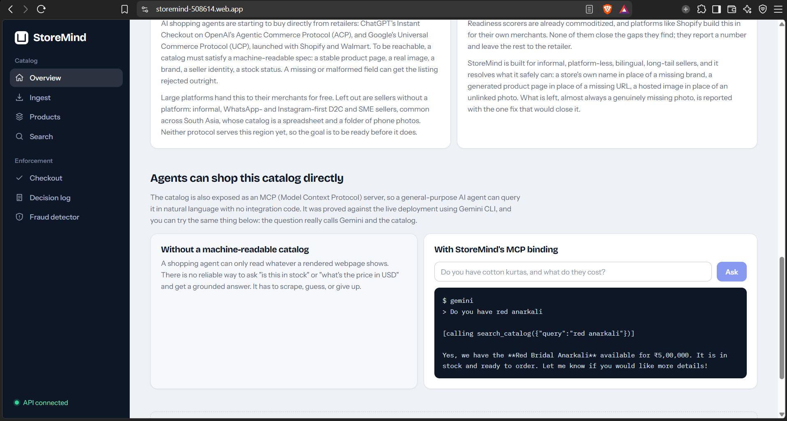

# StoreMind

**Enforced, not just scored.**
An agent-readiness and commerce-intelligence copilot that turns the messy catalogs of India's SME/D2C sellers into products AI shopping agents can safely read and buy, and *blocks* the ones that aren't ready.

[**Open the live app**](https://storemind-508614.web.app/) · [Architecture](#architecture) · [Results](#results-and-honest-limits)


Built by **Team Retail Revoluts** for the Google Cloud AI Builder Cup 2026, Retail & Commerce track.

---

## Contents

1. [The problem](#the-problem)
2. [Who it is for](#who-it-is-for)
3. [What StoreMind does about it](#what-storemind-does-about-it)
4. [Problem-statement alignment](#problem-statement-alignment)
5. [One product, start to finish](#one-product-start-to-finish)
6. [Impact](#impact)
7. [Built to be trusted](#built-to-be-trusted)
8. [Architecture](#architecture)
9. [How the pipeline works](#how-the-pipeline-works)
10. [Google Cloud services](#google-cloud-services)
11. [Results and honest limits](#results-and-honest-limits)
12. [Screenshots](#screenshots)
13. [Run it locally (fully offline)](#run-it-locally-fully-offline)
14. [Configuration](#configuration)
15. [Tests and demo evidence](#tests-and-demo-evidence)
16. [Repository layout](#repository-layout)
17. [Scope and roadmap](#scope-and-roadmap)
18. [Team](#team)

---

## The problem

AI shopping agents (ChatGPT, Gemini and others) are becoming a real way to buy things. Platforms are starting to let agents transact with merchants directly, through protocols such as OpenAI's **ACP** and Google's **UCP**, and India has its own open commerce network, **ONDC**.

But an agent can only transact safely with a catalog it can read reliably, and that is exactly what small Indian sellers do not have:

| What goes wrong | Why it matters |
|---|---|
| The catalog lives in **WhatsApp photos and spreadsheets**, not structured feeds | An agent cannot reliably ask "is this in stock?" or "what is the price?" and get a grounded answer. It scrapes, guesses or gives up |
| Fields are missing, garbled or inconsistent: no brand, no net quantity, mojibake text, prices like `₹1,50,000` or `Rs1500` | Parsers built for Western formats misread Indian price grouping and lose the currency |
| An LLM that "cleans" thin data **invents** plausible-looking brand names, quantities and dates | A listing that looks complete but is fabricated is worse than an honest gap |
| Readiness tools stop at a **score on a dashboard** | The score is advice. Nothing stops an unready product from being reachable by an agent |
| Identity checks assume a **GSTIN** | Informal, WhatsApp/Instagram-native sellers are locked out of the very trust signal agents need |
| Cash-on-delivery refusals and return abuse hit small sellers hard | Wasted shipping and returns are a direct margin loss, and COD is common in this segment |

## Who it is for

- **Primary users:** SME and D2C retailers in India, especially informal, WhatsApp/Instagram-native sellers with catalogs in photos and spreadsheets.
- **Downstream beneficiaries:** AI shopping agents and the platforms behind them (they get a catalog they can query and transact against safely), and the shoppers those agents serve.

## What StoreMind does about it

StoreMind takes a messy catalog in, and lets only the products that pass a hard gate reach an agent.

| Problem | StoreMind's answer |
|---|---|
| Messy catalogs | **Layer-0 validator** (no LLM): locale-aware price parsing (Indian lakh/crore grouping, SEA thousands separators), mojibake detection, duplicate-SKU handling. Then a **Catalog Structuring Agent** (Gemini on Vertex AI) extracts name, category, description, attributes, keywords and price |
| Fabrication | Brand, net quantity and manufacture date are extracted **only when genuinely present in the source**. A grounding check rejects any value not traceable to source text |
| Gaps the model could have fixed | A bounded **Reflexion** loop retries *model-fixable* gaps, grounded against the source. *Source-limited* gaps (genuinely absent) are never retried. Validated corrections persist to an **episodic memory** and inform later rows |
| Score without consequence | A **six-component readiness rubric**, dominated by *source richness* (45% weight), feeds a **fail-closed checkout gate**: below threshold means blocked, not flagged |
| Agents can't read the catalog | Eligible products are mapped to **ACP, UCP and ONDC** and served through an agent-facing storefront and a mounted **MCP** endpoint |
| Identity lock-out | **Either-or seller verification**: GSTIN *or* Udyam *or* UPI+PAN *or* UPI+WhatsApp |
| COD and return fraud | A **fraud signal detector** for return and COD-refusal patterns, measured against a labeled test harness |

**Why "enforced, not just scored" is the differentiator:** scoring a catalog and stopping at a dashboard leaves unready products reachable by agents. StoreMind makes the score a gate that the checkout endpoint and the live MCP tool actually obey, and logs every decision with its reason.

---

## Problem-statement alignment

The track asks for an AI-powered solution that *transforms how businesses understand, engage, and serve customers while improving operational efficiency across physical and digital commerce*, and lists discovery, personalization, conversational shopping, demand planning, inventory, customer insights and fraud as example areas.

| Track area | How StoreMind addresses it |
|---|---|
| **Discovery** | Agent-facing storefront search over structured, gate-passing products |
| **Conversational shopping** | A mounted MCP endpoint (`/mcp/ask`) lets a general-purpose agent query the catalog in natural language. Proven against Gemini CLI in production |
| **Fraud** | Return and COD-refusal signal detection: bracketing, wardrobing, high refusal rate, unreachable-customer patterns |
| **Operational efficiency** | Messy WhatsApp/spreadsheet rows become structured, scored, protocol-mapped listings without manual re-entry |
| **Serving customers safely** | Agents and shoppers only reach products that passed the gate, with every decision logged |
| **Physical and digital commerce** | Built for sellers whose commerce is informal and chat-based, and for the agent-driven digital surface that is emerging |

Areas StoreMind deliberately does not cover: personalization, demand planning, inventory forecasting.

---

## One product, start to finish

Meet **Meera**, a made-up seller (the products below are from the demo catalog). She sells on WhatsApp and keeps her catalog as a spreadsheet and phone photos.

1. **She uploads rows.** One is *Organic Turmeric Powder Pouch*, with a real description. Another is just a name like `Item` with no description and no image.
2. **Layer-0** cleans the prices and flags encoding problems before any model is called.
3. **The structuring agent** extracts fields. Where the source has no brand or quantity, it leaves them empty rather than inventing them.
4. **Reflexion** retries only the gaps the source can actually answer, and skips the ones it can't.
5. **The readiness score** reads the *raw input*, not just Gemini's polished output. In the demo checkout screen the turmeric pouch scores **89.5** against a gate threshold of **70** and passes. The thin product scores **59.8** and is blocked.
6. **An agent shows up.** Through the storefront or the MCP endpoint, it can see and check out the turmeric pouch. The thin product is rejected at checkout, and both attempts appear in the decision log with their reasons.
7. **Meera's identity** is verified through whichever path she has: GSTIN, Udyam, UPI+PAN or UPI+WhatsApp.

---

## Impact

**What changes for each party**

| Who | Before StoreMind | With StoreMind |
|---|---|---|
| **Informal SME/D2C seller** | Catalog invisible to agents; no way to know what is wrong with a listing | Structured, scored, protocol-mapped catalog, with gaps explained rather than hidden. Verification that fits an informal business |
| **AI shopping agent / platform** | Scrapes pages, guesses prices and stock, risks buying from thin or fabricated listings | A machine-readable storefront and MCP tool that only returns products that passed a hard gate |
| **Shopper** | Exposed to listings that look complete but are fabricated | Agents transact only against grounded data |
| **Seller margin** | Wasted shipping and returns from COD refusals and return abuse | Early signals for COD and return fraud patterns |

**What we have measured** (labeled harnesses, not production-wide claims): see [Results and honest limits](#results-and-honest-limits).

**Alignment with the UN Sustainable Development Goals:** SDG 8 (decent work and economic growth, through helping small enterprises participate in digital commerce) and SDG 9 (industry, innovation and infrastructure, through giving small sellers access to new commerce infrastructure).

---

## Built to be trusted

| Principle | How it is done |
|---|---|
| **Fail-closed, not advisory** | Below-threshold products are blocked at the mock checkout endpoint and at the live MCP tool. If the gate cannot decide, it does not allow |
| **The model never gets to invent** | Brand, net quantity and manufacture date are only accepted when present in the source. Every Reflexion retry is grounded against the source text before it is trusted, so a correction can never become a fabrication |
| **Score reflects input, not output** | The original score measured the shape of Gemini's output and could rate a near-empty row highly. The redesigned rubric gives *source richness* 45% weight and scores the raw input. After the fix, a thin row that had scored about 90 scored about 55 and was blocked. A permanent regression test (`test_fabrication_from_thin_input_is_caught`) guards it |
| **Deterministic first, AI second** | Price parsing, mojibake detection, dedup, currency inference, seller-identity checks and fraud signals are deterministic code. Gemini is used where generation is actually needed |
| **Every decision is logged** | `GET /decision-log` returns each gate decision with its reason |
| **Never silently guess** | A currency inferred from the store's other products (no marker in the row) is always tagged `currency_inferred: true`, with its confidence, and shown as such in the UI |
| **Offline-first, swappable backends** | The entire pipeline runs and tests with zero GCP access (`mock` / `local`), and switches to Vertex AI and Firestore by environment variable |
| **Honest about limits** | PAN and Udyam have no published checksum, so they are structure-checked only. GSTIN is checksum-validated. Results are labeled as preliminary harness results |

---

## Architecture



*Firestore is the single source of truth across every stage: structured products, the decision log, seller verification state, Reflexion's episodic memory and UCP checkout session state.*

### The gate in motion



### Reflexion with grounded memory



---

## How the pipeline works

| Stage | What happens |
|---|---|
| **1. Ingest** | A WhatsApp photo or spreadsheet row arrives through the React app. Images that arrive as raw bytes rather than public URLs are stored in Cloud Storage |
| **2. Layer-0 validation** | Deterministic, no LLM: locale-aware price parsing (Indian lakh/crore via Babel, `price-parser` for other currencies), script detection (including Thai, Khmer, Lao, Myanmar), mojibake detection, duplicate-SKU handling, and confidence-thresholded currency inference for prices with no marker |
| **3. Structuring + Reflexion** | Gemini (Vertex AI) extracts the fields. Reflexion classifies each gap, retries only the model-fixable ones, grounds every retry against the source, and recalls past corrections from episodic memory (before attempt 1 by raw category, at retry time by classified tags and semantic similarity) |
| **4. Score + gate** | A six-component rubric, led by source richness (45%), produces the readiness score. Products below threshold are blocked at checkout |
| **5. Serve** | Eligible products are mapped to ACP, UCP and ONDC, and served through the agent-facing storefront and the mounted MCP endpoint |

**Seller identity (either-or, offline, deterministic)**

| Path | Check |
|---|---|
| GSTIN | Checksum-validated |
| Udyam | Structure-only (no published checksum) |
| UPI + PAN | PAN structure-only (no published checksum) |
| UPI + WhatsApp | Offline, deterministic |

**Fraud Signal Detector.** Return fraud (bracketing, wardrobing) and a separate COD-refusal scenario type (high refusal or non-delivery rate, COD bracketing, repeated "customer unreachable"). COD is its own scenario type because a refusal happens before the item is accepted, so return-style checks like days-held do not apply.

---

## Google Cloud services

| Service | Role |
|---|---|
| **Cloud Run** | FastAPI backend: ingestion, the agent-facing storefront, the fail-closed gate and the mounted MCP server (region `us-central1`) |
| **Firestore** | Single source of truth: products, decision log, seller verification state, the `reflections` collection with native vector search over Gemini embeddings, and UCP checkout session and idempotency state |
| **Vertex AI (Gemini)** | `gemini-3.6-flash` for catalog structuring, vision-based brand extraction and Reflexion. `gemini-embedding-001` for episodic-memory retrieval |
| **Firebase Hosting** | Serves the React frontend |
| **Cloud Storage** | Seller-supplied product images that arrive as raw bytes |

---

## Results and honest limits

These are results from **labeled harnesses on small fixture sets**. They are preliminary and are not production-wide claims.

| What | Result |
|---|---|
| **Test suite** | 483 tests passing (`pytest`) |
| **Reflexion A/B** (10 labeled rows, with vs without Reflexion) | Average readiness **68.7 → 72.8 (+4.1 points)**. 8 of 10 rows improved, 9 of 10 were retried, the source-limited row was skipped, and the best single gain was +8.3 points |
| **Threshold outcome of that run** | 7 of 10 rows passed both before and after, so there was **no net increase in rows clearing the threshold** in this run |
| **Fabrication guardrail** | 0 fabrication attempts blocked, which is the expected value for this fixture set. The grounding check rejects any value not traceable to source text |
| **Fraud detector** | Exploratory. Measured against 9 stored labeled scenarios |

Reproduce the A/B and fraud numbers with `GET /reflexion/ab-harness` (or `python3 reflexion_ab_harness.py`) and `GET /fraud/test-harness`.

**Limits we state plainly**

- The Reflexion lift is a score lift on a 10-row set. It did not change how many rows cleared the gate in that run.
- The fraud detector is exploratory and its accuracy readout covers the stored scenarios only.
- Seller verification is offline and structural. It is not a live check against a government or payments system.
- Live ONDC network participation is not implemented (see [Scope and roadmap](#scope-and-roadmap)).

---

## Screenshots


| | |
|---|---|
| **Ingest:** raw rows in, per-row result out (one eligible, one blocked) | **Products:** readiness, gate state and ACP/UCP/ONDC eligibility per product, with the reason on hover |
|  |  |
| **Checkout gate:** an eligible product passes and a blocked one is rejected by the same endpoint | **Decision log:** every checkout decision with its reason |
|  |  |
| **Live MCP agent query:** a general-purpose agent asking the catalog a question in natural language | |
|  | |

---

## Run it locally (fully offline)

No Google account or GCP project is needed. With the default `mock` and `local` backends the whole pipeline runs and the tests pass offline.

```bash
git clone https://github.com/Crunchygrunt/Retail_Revoluts_StoreMind.git
cd Retail_Revoluts_StoreMind/app

python -m venv .venv
source .venv/bin/activate          # Windows: .venv\Scripts\activate
pip install -r requirements.txt

cp deploy.env.example deploy.env   # leave as mock/local, or fill in your own values
cp seller.env.example seller.env

uvicorn main:app --reload --port 8080
```

- Interactive API docs: <http://localhost:8080/docs>
- Frontend: point `storemind-frontend/`'s `api.js` base URL at `localhost:8080`, then:

```bash
cd storemind-frontend
npm install
npm run dev
```

**To run against real Google Cloud**, set the backend variables below and provide your own Vertex AI and Firestore access.

---

## Configuration

Every backend is swappable by environment variable, with no code changes.

| Variable | Values | Meaning |
|---|---|---|
| `STOREMIND_LLM_BACKEND` | `mock` \| `aistudio` \| `vertexai` | Which LLM backend structures the catalog. Production uses `vertexai` |
| `STOREMIND_STORE_BACKEND` | `local` \| `firestore` | Where data is stored. Production uses `firestore` |
| `STOREMIND_IMAGE_BACKEND` | production uses `gcs` | Where seller-supplied image bytes go |

Templates: `deploy.env.example` and `seller.env.example`. Do not commit real values.

---

## Tests and demo evidence

```bash
cd app
python -m pytest -v
```

| Evidence endpoint | What it shows |
|---|---|
| `GET /fraud/test-harness` | Runs the labeled return and COD scenarios and returns an accuracy readout |
| `GET /reflexion/ab-harness` | Runs the labeled 10-row dataset with and without Reflexion, and returns the measured readiness lift and threshold-crossing delta |
| `GET /decision-log` | Every gate decision made, with its reason |
| `/docs` | Interactive API documentation |

---

## Repository layout

```
app/
  main.py                      FastAPI app: all routes
  catalog_agent*.py            Three interchangeable structuring backends (vertexai / aistudio / mock)
  reflexion*.py                Self-correction loop, gap classifier, episodic memory
  readiness_score.py           The fabrication-resistant scoring rubric
  acp_schema.py / ucp_*.py / ondc_*.py   Protocol conformance and eligibility
  seller_profile.py / *_validator.py     Either-or seller identity verification
  fraud_detector.py            Return and COD fraud signal detection
  storefront.py                Agent-facing search and fail-closed checkout
  firestore_client.py / local_store.py   Swappable storage backends
  tests/                       pytest suite (483 passing)
storemind-frontend/
  src/pages/IngestPage.jsx     Catalog ingestion UI, including the Reflexion transparency panel
  ...
```

---

## Scope and roadmap

**India-first by design.** StoreMind is the AI-readiness layer for India's fragmented commerce ecosystem, not an ONDC catalog validator. India-specific behavior lives at the product layer (price formats, GSTIN/Udyam/UPI identity, COD fraud, ONDC mapping). The core is geography-agnostic: money is a normalized object (amount, currency, precision, raw value, confidence, source) with country-specific behavior isolated behind locale adapters. Other countries become country packs only after the core is proven in India.

**Deliberately out of scope**

- Live ONDC network participation (registry onboarding, `/select`, `/init`, `/confirm`). We do catalog conformance only.
- Live financial verification such as a UPI penny-drop. It would duplicate the offline either-or system we built and conflicts with our "no paid live APIs" constraint.
- A central OAuth authorization server. Neither UCP nor ACP requires one for agent-to-merchant trust, since both use signed requests.

**Roadmap**

- **Progressive trust ladder:** tiered checkout eligibility that unlocks as a seller completes orders, with a soft-fail GSTIN live-lookup enrichment. Designed in detail, deferred from this submission.
- **Merchant-verification dimension in readiness:** open question of whether identity should become part of the readiness score itself.
- **Country packs** behind the locale-adapter boundary, once the India core is proven.

---

## Team

**Retail Revoluts**, team members **Yuvraj Singh** & **Himanshu Raj**. Built for the Google Cloud AI Builder Cup 2026, Retail & Commerce track.